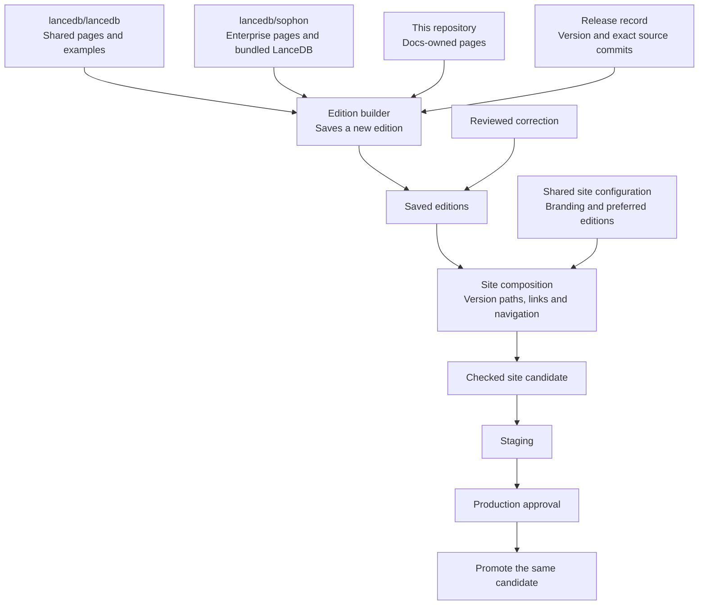
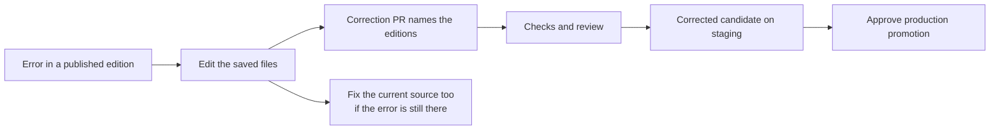

# Versioned documentation

Readers should find the documentation for the product version they use.
Engineers keep writing documentation beside the product code, in
`lancedb/lancedb` and `lancedb/sophon`. Release automation prepares each
version's documentation, and people review it before it is merged and before
it reaches production.

This is the design that work follows. It is built in four steps:

1. **Release records and saved editions.** A record names one release's
   sources, and a manual command saves the edition built from them. This step
   is in place: see [Saved editions](README.md#saved-editions).
2. **Composing editions into the site:** version paths, links, navigation,
   selectors, redirects and an "About this version" page for each edition.
3. **Supervised publication:** merged editions and corrections go to staging
   automatically, and a person approves promoting that same candidate to
   production.
4. **Release discovery:** each product's own qualification signal starts the
   same preparation, and a bot opens the documentation pull request.

Until steps 2 and 3 are in place and a cutover is approved, the site is built
and published as it is today, and production stays where it is.

## Decisions

| Topic | Decision |
| --- | --- |
| Hosting | Mintlify, with its native product and version selectors. |
| Default | The latest approved, published Enterprise edition. |
| Unversioned links | Resolve to the same page in that edition. Versioned links stay in their edition. |
| Navigation | Every edition keeps the full documentation set, with OSS and Enterprise badges. |
| Release cadence | OSS and Enterprise editions publish independently. An Enterprise release needs no new OSS release. |
| Enterprise sources | An Enterprise edition uses its own pages and the shared pages of the exact LanceDB it bundles, which may be an older release or a commit no release tags. |
| History | No backfill. Editions start with releases that have their documentation sources. |
| Storage | One folder per edition, all on one branch of this repository. |
| Corrections | A reviewed edit to a saved edition is allowed for a historical correction. Fix the current source too when the error is still there. |
| Automation | Preparation, checks, pull requests and staging are automated. People review before merging and approve production promotion. |
| Missing page on version switch | Mintlify's native fallback, with no custom switching logic. |

"Latest" means the approved preferred edition of a product, not whichever job
finished last. A later maintenance release must not replace a newer preferred
release line. Selecting the latest Enterprise edition does not select the
latest OSS edition: the LanceDB it bundles can be older.

## Components



These are parts of the existing tooling, not new services.

- **Edition builder** (`scripts/edition.py`) reads the recorded commits,
  builds the edition with the existing assembler, and saves it. The assembler
  stays where pages are composed: overlays, examples written into pages,
  availability badges and native drafts all come from it.
- **Saved edition**: the pages, assets, navigation and draft controls of one
  release. Later builds never fetch fresh content into it.
- **Site composition** gives each saved edition its version path and builds
  the navigation and redirects. It does not rebuild editions.
- **Publisher** puts the checked candidate on staging and, after approval, the
  same candidate on production.

Global branding and Mintlify's renderer change independently of editions, so
a saved edition keeps its content, not its exact pixels.

## Editions and their records

```text
releases/
  oss-<version>.yaml
  enterprise-<version>.yaml
editions/
  oss/<version>/
  enterprise/<version>/
```

A record names the product and version, the release tag and commit, the
Enterprise qualification tag, the LanceDB an Enterprise release bundles, and
the commit of every root the assembler read, including this repository's own
pages (Geneva, the dataset cards and the REST API specification) and the
specification's upstream release. Older editions never inherit today's shared
pages.

Saved editions are kept by default but are not immutable. A reviewed
correction changes an edition's files at the same URL. The record keeps the
original sources and the checksum of the snapshot as prepared, lists each
correction, and Git history holds the correction pull requests. Publication
checksums describe the corrected candidate.

Preparation never overwrites a saved edition:

- The same release prepared again from the same release commits changes
  nothing, even after the edition has been corrected. A later commit of this
  repository does not make it a different release.
- Different commits for a saved release, such as a moved tag or another
  Enterprise source, stop preparation for review.
- A failed preparation leaves no edition and no record.

## Preparing a release

The manual command and later automatic discovery run the same preparation.
Nobody assembles files by hand.

**Enterprise.** Preparation takes the `lancedb/sophon` release tag, which must
be qualified, reads the LanceDB commit that release bundles, and takes the
shared pages from that commit. A standalone OSS edition is not needed.

**OSS.** Preparation takes the `lancedb/lancedb` release tag. The full
navigation includes the Enterprise pages, so the `lancedb/sophon` tag or commit
they come from is named explicitly. Nothing reads Sophon's `main` or infers a
compatibility relationship.

A missing tag, absent documentation, an unqualified or inconsistently tagged
Enterprise release, or private-source files that may not be published stop
preparation with the reason. Nothing is made up from today's sources.

The bundled LanceDB is not a client SDK compatibility matrix. Client minimum
versions belong beside the examples they apply to, when evidence supports
them, and the tested client version is not a claimed minimum.

## Corrections



A correction to a saved Enterprise edition edits its folder and keeps its
version and URL. It needs no product release and no historical source branch.

Corrections are explicit. If three editions are wrong, the pull request names
and edits all three. Checking a corrected example fits the example; a typo
needs no SDK test suite. Preparing a release again never rebuilds a corrected
edition from its original sources.

## Reader behavior

Site composition will provide this:

- First-time readers land on the latest published Enterprise edition.
- Unversioned links go to the same page in that edition. Redirects come from
  the actual page map and keep valid anchors; paths are not blindly prefixed.
- Versioned links stay in their edition.
- Readers can choose the newest OSS edition independently.
- Selectors use short labels. An "About this version" page shows the full
  release identity and its sources.
- Version switching is Mintlify's own. In a hosted trial, switching from a
  page that only a newer version has landed on another page of the older
  version, without explanation. That is Mintlify's fallback, not a promise.
- Test versions and probe pages never ship as editions.

An old unversioned URL with no matching page still needs a policy. A
catch-all redirect that hides missing content is not one.

## Publication and discovery

At first the preparation bot opens pull requests and does not merge them. A
merged edition or correction goes to staging. Production needs a person's
approval of the candidate that was reviewed. A stale approval cannot promote a
different candidate, and an older queued run cannot overwrite a newer
approved publication or change the preferred edition. Promotion reuses the
staged artifact.

Missing qualification, absent sources, ambiguous inputs or failed checks stop
the workflow with a report. Duplicate events are harmless.

Rolling back changes the preferred edition and keeps published folders.
Restoring an earlier whole-site build would remove newer editions, so it needs
a deliberate decision.

Merging and production promotion can later become automatic, separately.
That changes approval policy, not the builder or the publisher.

## Open questions

These are settled where they first matter, before production:

1. Each product's qualification signal for discovery. Enterprise releases
   carry a qualification tag, which preparation already requires. For OSS,
   the stable-release completion signal, beta and release-candidate handling,
   and the release owner's approval are still to be confirmed.
2. Which Enterprise source supplies the Enterprise pages of an OSS edition.
   Preparation takes it explicitly until this is decided.
3. Missing targets for legacy URLs.
4. Approval enforcement in the repository, and the supported Mintlify staging
   setup.
5. Preferred-release order across stable and maintenance lines.

**Enterprise pages without placeholders.** The assembler currently needs an
OSS page at the same path for every Enterprise page. Removing that
requirement, with its navigation and draft handling, is a separate change that
must land before the first real editions. Editions save whatever the
assembler builds, so they need no change for it. Once it lands, prepare test
editions again and check Enterprise-only pages, intentional overlays,
navigation and hidden drafts together.
