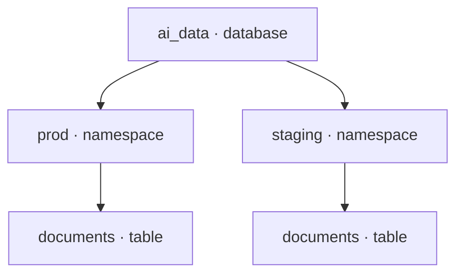

## Catalog overview {#catalog}

A catalog keeps track of named data objects, such as tables and views, so
applications can discover and access them. In LanceDB, it organizes those
objects into databases and namespaces.

## Databases, namespaces and tables {#objects}

A database contains namespaces that group related tables and views. Namespaces
can also contain other namespaces, allowing teams to organize data by project,
environment or purpose.

For example, a search application can keep production and staging data in
separate namespaces within the same database:

| Object | What it represents |
| --- | --- |
| [Database](/enterprise/v1-10-1/management/database) | A container for namespaces and their data objects. |
| [Namespace](/enterprise/v1-10-1/management/namespace) | A named group of tables, views or nested namespaces. |
| [Table](/enterprise/v1-10-1/management/table) | Data stored as rows and columns. |
| [View](/enterprise/v1-10-1/management/view) | A saved query, evaluated when read. Available in Enterprise. |
| [Materialized view](/enterprise/v1-10-1/management/materialized-view) | The stored results of a query, updated by a refresh. |

{/*
Draft for the Functions release. Add this row to the table above:
| [Function](/management/function) | Registered code used to compute column values. Available in Enterprise. |
*/}

## Organization and access control {#governance}

- **Separate projects and environments.** Keep production and staging tables
  in distinct namespaces, even when they use the same table names.
- **Find shared datasets.** Give teams a consistent place to discover and
  access the data they work with.
- **Control access in Enterprise.** Use permissions on databases, namespaces
  and tables to manage who can access shared data and what they can do with it.

## Learn more {#next}

- [Databases](/enterprise/v1-10-1/management/database): connect to and manage a database.
- [Namespaces](/enterprise/v1-10-1/management/namespace): create groups and address tables within them.
- [Tables](/enterprise/v1-10-1/management/table): create, inspect and manage your data.
- [Views](/enterprise/v1-10-1/management/view) and [materialized views](/enterprise/v1-10-1/management/materialized-view): work with query-defined data.
- [Authorization](/enterprise/v1-10-1/governance/authorization): configure Enterprise access permissions.
